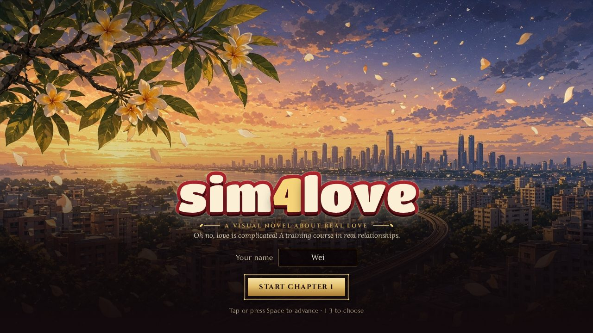

# sim4love 💗

**A hand-drawn anime-style visual novel about love, choices, and becoming someone you like.**

> One ordinary year in Singapore. Five very different people. Every choice you make says something about who you are.

**▶ Play in your browser:** https://sim4love.jstdlee.workers.dev

---

## At a glance

| | |
|---|---|
| **Genre** | Branching visual novel · romance · life sim |
| **Length** | 20 chapters in 5 parts, about 2–3 hours for one run |
| **Choices** | 240+ decisions, 40+ rewindable bad endings, many routes and endings |
| **Extras** | 119 notebook lessons, achievements, 7 Think Deeper cards |
| **Languages** | English and Simplified Chinese (简体中文), switchable any time |
| **Platforms** | Any modern browser, desktop or phone. No install, no account, no ads |
| **Rating** | 16+ (see the content note) |

<p align="center"></p>

## What kind of game is this?

sim4love is a **branching romance visual novel** with a heart: it's funny, a little chaotic, and quietly honest
about what makes relationships healthy. You're not here to "win" anyone. You're here to find out what you want
from love, and from your own life.

## Features

- 🌿 **Branching story.** Your choices change conversations, relationships and the path you end up on. Wrong turns
  lead to (often ridiculous) bad endings you can instantly rewind.
- 💞 **Multiple heroines with distinct values.** Everyone has her own views on money, family, career, friendship
  and the future. Sometimes you'll agree. Sometimes you won't, and learning to disagree well is the point.
- 📊 **Your Life meters.** Love is only one part of life. Your goals, passion, health and wallet matter too.
- 🔍 **Think Deeper cards.** Optional, balanced reflections on the bigger pressures behind everyday arguments:
  money, careers, housing, family and more. No lectures, no right answer.
- 🎬 **Multiple endings.** Different routes, different outcomes. Some of the best endings aren't the obvious ones.
- 🇸🇬 **Singapore setting.** School days, hawker food, the MRT and HDB life, in a multicultural cast.
- 🆘 **Help resources.** Where the story touches on serious topics, in-game cards point to real, verified Singapore
  support services.
- 🎵 **Original soundtrack.** Ten short looping moods that follow the scene, with smooth crossfades. Volume and
  mute are in Settings. All music is original and released CC0 (see [`docs/MUSIC_CREDITS.md`](docs/MUSIC_CREDITS.md)).
- 🌏 **English and 简体中文.** The whole game, including every help card, is fully translated. It picks your
  browser's language the first time; change it on the title screen or in Settings.
- 📱 Phone chats, a notebook of what you've learned, achievements, autosave, and a mobile-first dark-and-gold UI.

## Review (our own take)

> An honest self-review from the team that made it, not a press quote.
>
> **Verdict: 8.5 / 10. A dating sim that cares more about you than about your score.**

| | Score | Notes |
|---|---|---|
| Story & writing | 9 | Warm, often very funny, and it surprises you. The quiet moments land as well as the jokes. |
| Choices that matter | 9 | Decisions carry across chapters. Values clash in ways that feel fair to everyone. |
| Art & presentation | 8 | Lovely hand-drawn cast and locations, a stylish dark-and-gold interface, phone chats in the story. |
| Replay value | 9 | Routes, secret endings, and a notebook that fills in only if you try other paths. |
| Learning without lectures | 9 | You come away knowing more about real relationships. It never feels like homework. |
| Polish | 7.5 | Smooth on desktop and phone, with autosave, keyboard shortcuts and a gentle original soundtrack. No voice acting. |

**Liked:** bad endings you can rewind straight away and actually want to see · characters who are more than their
archetype · a Singapore setting that feels lived in · it never shames the player.

**Could be better:** no voice acting · only two languages so far · a few chapters are dense with
choices if you prefer a relaxed read.

## Content note

Rated **16+**. The game deals with dating, peer pressure, online scams and relationship red flags, always in an
educational, non-graphic way. There is **no explicit content**: the most you'll see on screen is a hug.

## How to play

- **Online:** open the live link above. Works on desktop and mobile browsers.
- **Offline:** download or clone this repository and open `index.html` in a modern browser. No build step.
- **Local server (optional):** `npx serve .` (or any static file server), then open the address it prints.
- **Deploy your own copy:** `npx wrangler deploy` (Cloudflare Workers static assets, see `wrangler.jsonc`).

Progress, language and music settings save automatically in your browser. The ⚙ button opens Settings.

## Development

```bash
node tests/validate.js   # script and data checks
node tests/softlock.js   # proves every path can move forward
node tests/playthrough.js first|last|random [--mobile] [--lang=zh] [--shots]   # browser playthrough (needs Playwright)
node tools/i18n-pack.js status   # translation coverage (Chinese sources live in i18n/zh-SG/)
python3 tools/make-music.py      # regenerate the soundtrack (numpy + ffmpeg)
```

Design and developer docs are in [`docs/`](docs/). ⚠️ They contain full spoilers.

## Tech

Vanilla HTML, CSS and JavaScript with a small custom visual-novel engine; no framework and no build step. Hosted as
static assets on Cloudflare Workers. All dialogue is authored by hand (no live AI at runtime).

## License

No open-source license has been chosen yet. Until one is added, all rights are reserved by the project owner.
